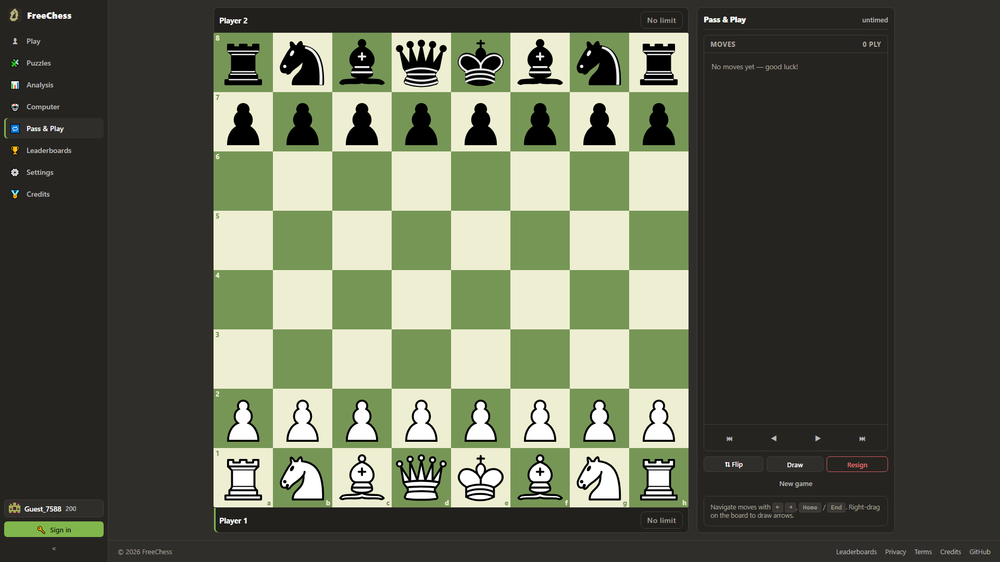
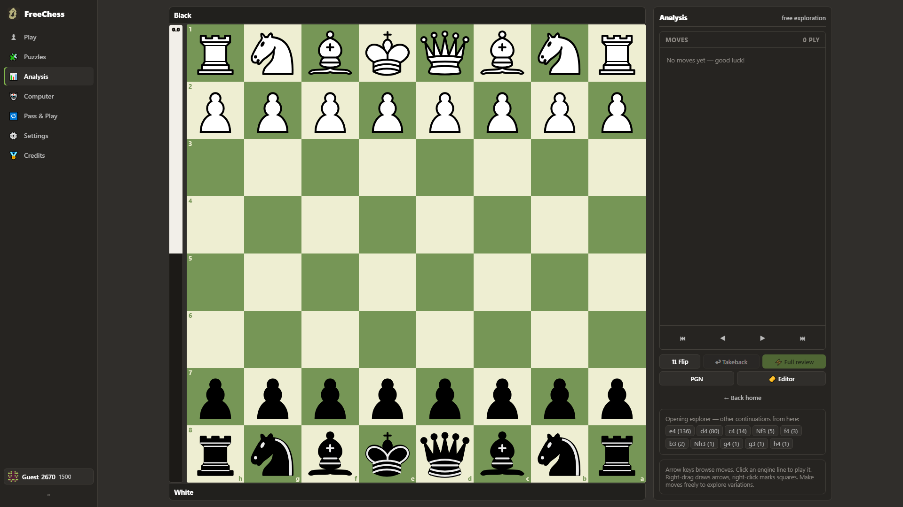

<div align="center">

  <h1>♟️ FreeChess</h1>

  <p><b>Real-time multiplayer chess platform with in-browser Stockfish WASM analysis</b></p>

  <p>
    An ad-free, friction-less web chess platform built with React 19, TypeScript, Vite, Supabase Realtime, and client-side Stockfish neural evaluation. Start a game in two clicks with no signup wall.
  </p>

  <p>
    <a href="https://chess-multiplayer-788.netlify.app"></a>
    <a href="https://react.dev"></a>
    <a href="https://www.typescriptlang.org"></a>
    <a href="https://vite.dev"></a>
    <a href="https://supabase.com"></a>
    <a href="LICENSE"></a>
  </p>

</div>

---

## 📖 Overview

**FreeChess** is a modern chess web application designed for instant, zero-friction play. Featuring anonymous one-click lobby generation, server-authoritative move validation via Postgres Row-Level Security, and instant state synchronization using Supabase Realtime channels.

Post-game evaluation runs entirely inside your browser using **Stockfish 19 compiled to WebAssembly (WASM)** executed in a background Web Worker, delivering deep engine evaluation, blunder detection, and best-move arrows with zero cloud API latency or subscriptions.

---

## 📸 Interface Preview

<table align="center">
  <tr>
    <td align="center" width="50%">
      <br /><br />
      <b>Live Multiplayer Match</b><br />
      <sub>Real-time clocks, move history, captured pieces & piece legal highlighting</sub>
    </td>
    <td align="center" width="50%">
      <br /><br />
      <b>In-Browser Stockfish Engine Analysis</b><br />
      <sub>WASM evaluation bar, principal variation lines, best-move arrows & depth tracking</sub>
    </td>
  </tr>
</table>

---

## 🚀 Key Features

- ⚡ **Zero-Friction Matchmaking** — Create or join a private game in seconds with anonymous sign-ins; no signup walls or credit cards.
- 🔄 **Supabase Realtime Synchronization** — Sub-second move broadcasting, draw offers, resignations, and disconnect tracking via WebSocket channels.
- 🧠 **Client-Side Stockfish WASM** — Runs Stockfish 19 locally in a dedicated Web Worker for evaluation curves, blunder indicators, and suggested moves.
- 🛡️ **Server-Enforced Game Integrity** — All moves validated via `chess.js` and secured by Supabase Postgres Row-Level Security (RLS) policies.
- 🎨 **Responsive Glassmorphic UI** — Fully responsive design adapted for desktop, tablet, and mobile with custom piece sets and audio synthesis.
- 🧪 **Comprehensive Test Suite** — Unit test coverage with Vitest and end-to-end browser automation with Playwright.

---

## 🛠️ Tech Stack

| Component | Technology | Purpose |
| :--- | :--- | :--- |
| **Frontend Framework** | [React 19](https://react.dev) | High-performance reactive UI |
| **Language** | [TypeScript 5.9](https://www.typescriptlang.org) | End-to-end type safety |
| **Build Tool** | [Vite 8](https://vite.dev) | Rapid HMR and optimized production bundles |
| **Chess Engine** | [Stockfish WASM](https://github.com/official-stockfish/Stockfish) & [chess.js](https://github.com/jhlywa/chess.js) | Client-side rules engine & multi-threaded WASM evaluation |
| **Backend & Realtime** | [Supabase](https://supabase.com) | PostgreSQL database, Auth, and Realtime WebSocket presence |
| **Hosting & CI/CD** | [Netlify](https://www.netlify.com) & GitHub Actions | Automated edge deployment on push to `main` |
| **Testing** | [Vitest](https://vitest.dev) & [Playwright](https://playwright.dev) | Unit testing and cross-browser E2E verification |

---

## 💻 Getting Started

### Prerequisites
- **Node.js**: `>= 20.x`
- **npm**: `>= 10.x`
- Free [Supabase](https://supabase.com) account (for self-hosting backend)

### Setup & Local Development

1. **Clone the repository**:
   ```bash
   git clone https://github.com/CodeByPartho/chess-multiplayer.git
   cd chess-multiplayer
   ```

2. **Install dependencies**:
   ```bash
   npm install
   ```

3. **Configure environment variables**:
   ```bash
   cp .env.example .env
   ```
   Provide your Supabase URL and anonymous public key in `.env`:
   ```env
   VITE_SUPABASE_URL=https://your-project-id.supabase.co
   VITE_SUPABASE_ANON_KEY=your-anon-key
   ```

4. **Start the local development server**:
   ```bash
   npm run dev
   ```
   Open `http://localhost:5173` in your browser.

5. **Run test suites**:
   ```bash
   npm run test        # Unit tests via Vitest
   npm run test:e2e    # E2E tests via Playwright
   ```

---

## 📄 License

This project is licensed under the **[MIT License](LICENSE)**.

---

<p align="center">Made with ❤️ by Partho</p>
