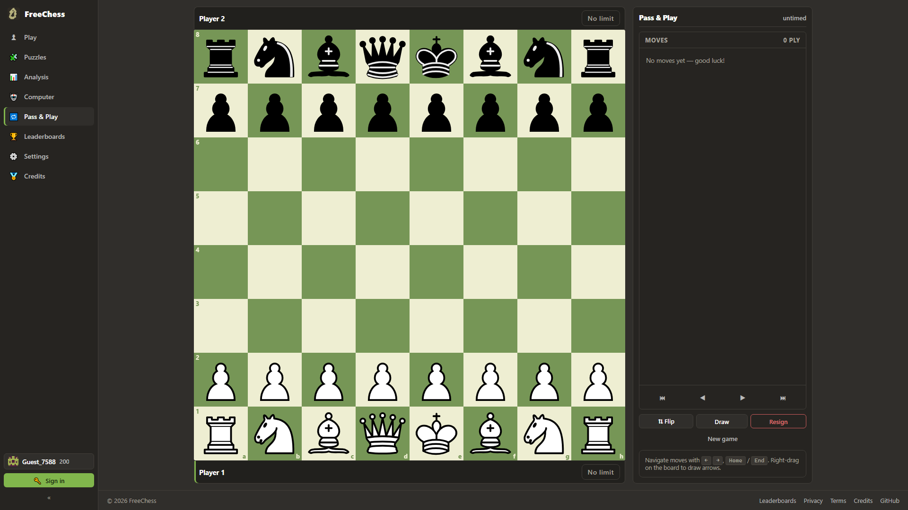
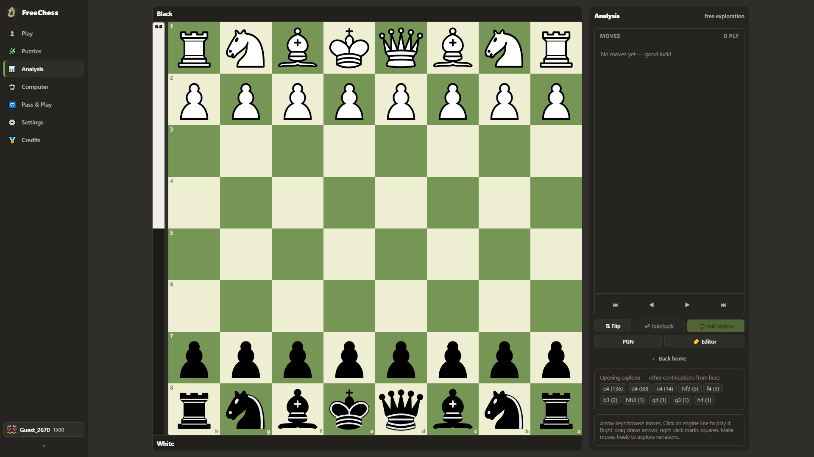

<div align="center">

 <h1>FreeChess</h1>

  <p><b>Multiplayer chess in the browser, with Stockfish analysis built in</b></p>

  <p>
    I built FreeChess because every big chess site either wants a subscription or shows ads. Here you open the page and play. No account needed, nothing to pay for. React 19, TypeScript, Vite, Supabase Realtime, and Stockfish running in your browser.
  </p>

  <p>
    <a href="https://playfreechess.netlify.app"></a>
    <a href="https://react.dev"></a>
    <a href="https://www.typescriptlang.org"></a>
    <a href="https://vite.dev"></a>
    <a href="https://supabase.com"></a>
    <a href="LICENSE"></a>
  </p>

</div>

---

## Overview

FreeChess is a chess site I built and run on my own. You can play online against other people, against the computer at 20 levels, or pass-and-play on one device. Online games are created from the lobby in a couple of clicks. You play as a guest by default; an account is only there if you want a permanent username and rating.

Moves are checked on the server side, not just in the browser tab. Game state lives in Postgres, moves go through Supabase Edge Functions that validate them with chess.js, and Row-Level Security policies keep players from touching games that are not theirs. Realtime channels carry the moves, chat, draw offers and rematch requests between the two players.

After a game you can review it with **Stockfish 19 compiled to WebAssembly**, running in a Web Worker in your own browser. It marks blunders and mistakes, shows the best line, and draws the best-move arrow. The same review on Chess.com is limited on the free plan. Here there is no plan.

---

## Interface Preview

<table align="center">
  <tr>
    <td align="center" width="50%">
      <br /><br />
      <b>Live game</b><br />
      <sub>Clocks, move list, captured pieces, legal-move dots</sub>
    </td>
    <td align="center" width="50%">
      <br /><br />
      <b>Analysis board</b><br />
      <sub>Eval bar, engine lines, best-move arrow, opening explorer</sub>
    </td>
  </tr>
</table>

---

## Key Features

- **Play in seconds.** Pick a time control and you are in a game. Guest play by default, private links for playing a friend.
- **Online play** on Supabase Realtime: moves, chat, draw offers, takebacks in casual games, rematches, and disconnect detection.
- **Stockfish in the browser.** Stockfish 19 (WASM) in a Web Worker powers the analysis board, hints, and the full game review with blunder detection.
- **Server-checked moves.** Edge Functions validate every move with `chess.js`; Postgres RLS policies protect the game rows.
- **Puzzles.** Daily puzzle, rated practice sets, and a 5-minute puzzle rush, all generated and verified with the rules engine.
- **Works on phones.** Responsive layout, seven board themes, piece sets, and synthesized move sounds. No app install.
- **Tests.** Vitest unit tests plus a Playwright end-to-end suite that plays full games between two browser contexts.

---

## Tech Stack

| Component | Technology | Purpose |
| :--- | :--- | :--- |
| **Frontend Framework** | [React 19](https://react.dev) | UI |
| **Language** | [TypeScript 5.9](https://www.typescriptlang.org) | Types across the app |
| **Build Tool** | [Vite 8](https://vite.dev) | Dev server and production build |
| **Chess Engine** | [Stockfish WASM](https://github.com/official-stockfish/Stockfish) & [chess.js](https://github.com/jhlywa/chess.js) | Rules, move validation, engine evaluation |
| **Backend & Realtime** | [Supabase](https://supabase.com) | Postgres, Auth, Edge Functions, Realtime |
| **Hosting & CI/CD** | [Netlify](https://www.netlify.com) & GitHub Actions | Deploys on push to `main` |
| **Testing** | [Vitest](https://vitest.dev) & [Playwright](https://playwright.dev) | Unit and end-to-end tests |

---

## Getting Started

### Prerequisites
- **Node.js**: `>= 20.x`
- **npm**: `>= 10.x`
- Free [Supabase](https://supabase.com) account (for self-hosting backend)

### Setup & Local Development

1. **Clone the repository**:
   ```bash
   git clone https://github.com/CodeByPartho/chess-multiplayer.git
   cd chess-multiplayer
   ```

2. **Install dependencies**:
   ```bash
   npm install
   ```

3. **Configure environment variables**:
   ```bash
   cp .env.example .env
   ```
   Provide your Supabase URL and anonymous public key in `.env`:
   ```env
   VITE_SUPABASE_URL=https://your-project-id.supabase.co
   VITE_SUPABASE_ANON_KEY=your-anon-key
   ```

4. **Start the local development server**:
   ```bash
   npm run dev
   ```
   Open `http://localhost:5173` in your browser.

5. **Run test suites**:
   ```bash
   npm run test        # Unit tests via Vitest
   npm run test:e2e    # E2E tests via Playwright
   ```

---

## License

This project is licensed under the **[MIT License](LICENSE)**.

---

<p align="center">Built by Partho</p>
